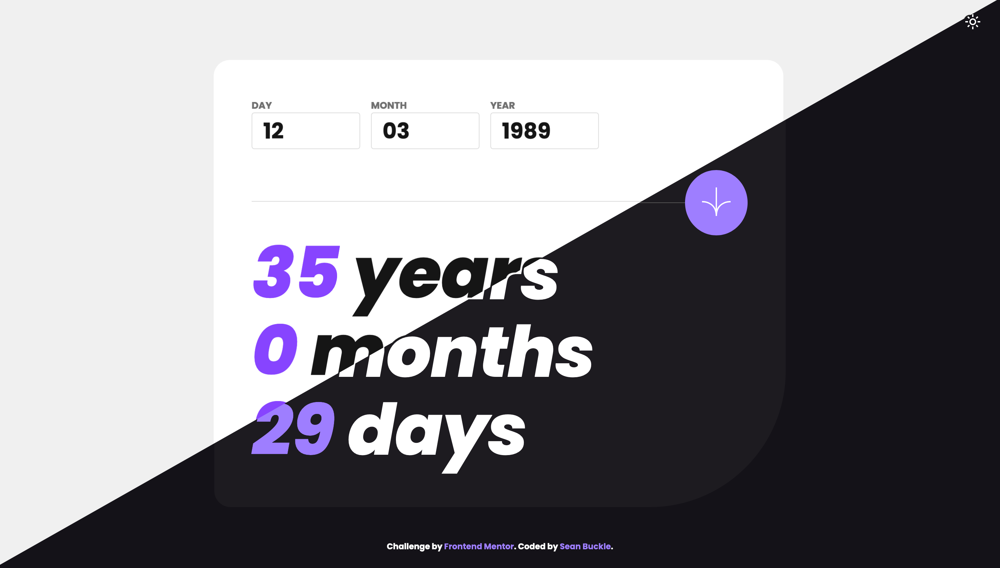

# Age Calculator | Precise Date Engine 🗓️

A high-performance age calculation application that determines exact years, months, and days based on user input. This project is built using the **Deno** runtime, leveraging its native TypeScript support and secure-by-default architecture.

## 📸 Preview



## 🚀 Technical Highlights

- **Runtime:** Deno (Secure-by-default, native TypeScript support).
- **Logic Engine:** TypeScript (Strict Mode) ensures fail-safe date parsing and calculation.
- **Styling Architecture:** Modular SCSS following the **BEM (Block Element Modifier)** methodology.
- **Modern CSS:** Utilizes CSS Custom Properties and native `light-dark()` support for system-aware theming.
- **Precision Validation:** Custom-built logic to handle inconsistent month lengths and leap year scenarios.

## 🏗️ Architectural Overview

### 1. Robust Temporal Validation

Date calculation is notoriously prone to "off-by-one" errors and logical edge cases. This solution implements a multi-tier validation engine:
- **Logical Consistency:** Validates inputs against the JavaScript Date object's rollover behavior to reject impossible dates (e.g., 31/04/1991 or 29/02 in non-leap years).
- **Boundary Control:** Enforces strict constraints for days (1-31), months (1-12), and ensures the input year is not in the future.
- **Accessible Validation:** Utilizes ARIA-compliant error patterns and real-time UI feedback, ensuring the validation logic is perceivable by all users, including those using assistive technologies.

### 2. State Persistence (LocalStorage)

To bridge the gap between a simple utility and a "product," I implemented a persistence layer using the Web Storage API:
- **Data Retention:** User inputs are automatically synchronized with localStorage. This prevents data loss on accidental page refreshes or tab closures.
- **Hydration Logic:** On initialization, the application checks for existing stored states and "hydrates" the UI, demonstrating a modern "resume-where-you-left-off" UX pattern.

### 3. Deno-Powered Development

Choosing Deno provided a modern, secure-by-default environment that significantly improved the developer experience (DX):
- * Native TypeScript: Eliminated the need for complex transpilation chains or build-tool overhead.
- * Security First: Leveraged Deno’s explicit permission system to ensure a secure local development environment.
- **Lightweight Footprint:** Utilized Deno's standard library to keep the project dependencies minimal and performant.

### 4. Scalable Style System (BEM + SCSS)

The UI architecture is built for maintainability and performance:
- **BEM Methodology:** Used to encapsulate styles, preventing specificity "leakage" and ensuring components remain modular.
- **Mobile-First Responsiveness:** Engineered with CSS Grid for form alignment and Flexbox for layout distribution.
- **Micro-Interactions: A custom** "count-up" animation was implemented using requestAnimationFrame to provide high-performance, fluid visual feedback on submission.

## 🛠️ Built With


## 🔗 Live Implementation

- **Live Site:** [https://age-calculator.seanbuckle.com](https://age-calculator.seanbuckle.com/)
- **Source Code:** [https://github.com/seanbuckle/age-calculator](https://github.com/seanbuckle/age-calculator)

## 🏁 Installation & Development

To run this project locally, ensure you have **Deno** installed:

1. **Clone the repository:**
   ```bash
   git clone https://github.com/seanbuckle/age-calculator.git
2. Navigate to the directory:
   ```bash
   cd age-calculator
4. Start the development server:
   ```bash
   deno task dev
   
## 👨‍💻 Author

**Sean Buckle**

[Frontend Mentor Profile](https://www.frontendmentor.io/profile/seanbuckle) 

[LinkedIn](https://www.linkedin.com/in/seanbuckle)

## 📜 License

This project is licensed under the MIT License - see the [LICENSE](https://github.com/seanbuckle/age-calculator/blob/main/LICENSE) file for details.

---

***Note: This project was built as a solution to a Frontend Mentor challenge.***
